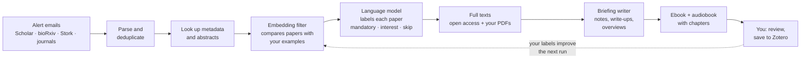
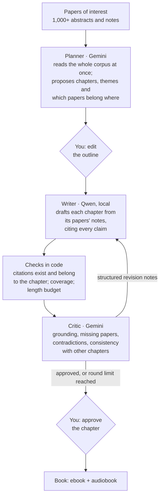

# paperflow

**Turn the flood of paper-alert emails into a weekly briefing you can read or listen to.**

If you subscribe to Google Scholar, bioRxiv, Stork or journal alerts, you know the problem:
hundreds of emails, a handful of papers that matter, and no time to find them. paperflow reads
those emails for you, removes duplicates, decides which papers are relevant to *your*
research, and writes a briefing: a full write-up of each paper you should know about, short
overviews of the rest, as an ebook and as an audiobook with a chapter per paper. Everything it
sees and decides goes into a personal database of the literature that has reached your inbox.



**What a week looks like:** export your alert folder, run `paperflow weekly`, then read or
listen to the briefing on your e-reader or phone, mark the few papers worth a full read, and
paste their DOIs into Zotero.

**Highlights**

- **Runs locally by default.** Triage and writing use an open model on your own GPU through
  [Ollama](https://ollama.com); the Claude API is an optional alternative.
- **Learns from you.** Example papers and your corrections steer both the filter and the
  model; your own labels always win.
- **Built for messy real-world input:** several alert services and their changing email
  layouts, preprint and published
  versions of the same paper merged, publisher URL quirks, rate-limited servers, models that
  run out of memory mid-run. Every step is resumable.
- **Honest briefings.** Write-ups use only what the paper says (from the full text where one
  is available, otherwise the abstract) and say which they were based on.

> **Status:** a working personal research tool, used weekly on a real alert stream of a few
> thousand papers. Expect rough edges; issues and pull requests are welcome. See
> [Planned work](#planned-work) for where it's headed.

---

## Contents

- [Requirements](#requirements)
- [Quick start](#quick-start)
- [Setup in detail](#setup-in-detail)
- [The first run: your backlog](#the-first-run-your-backlog)
- [The weekly routine](#the-weekly-routine)
- [Triage: how papers are sorted](#triage-how-papers-are-sorted)
- [Your reading: review, save, full texts](#your-reading-review-save-full-texts)
- [Briefings](#briefings)
- [Troubleshooting](#troubleshooting)
- [Command reference](#command-reference)
- [How it works](#how-it-works)
- [Privacy, cost and copyright](#privacy-cost-and-copyright)
- [Limitations](#limitations)
- [Planned work](#planned-work)
- [Development](#development)
- [Acknowledgements](#acknowledgements)

---

## Requirements

| | |
|---|---|
| **Operating system** | Linux, or Windows through WSL2 (developed on Ubuntu under WSL2). macOS should work but is untested. |
| **Python** | 3.10 or newer |
| **For the local model** | An NVIDIA GPU with about 12 GB of memory for the default model (`qwen3:14b`); an 8 GB GPU can run the smaller `qwen3:8b`. Without a suitable GPU, use the Claude API instead (paid per use). |
| **Memory** | 16 GB of system RAM recommended. Under WSL, give WSL at least 10 GB (see [Troubleshooting](#troubleshooting)). |
| **Disk** | About 15 GB for the models (language model, embedding model, voice). |
| **Email** | Alerts in Outlook (exported to a file), or any mailbox reachable by IMAP such as Gmail, or saved `.mbox` / `.eml` files. |

## Quick start

```bash
git clone <this repository> paperflow && cd paperflow
python -m venv .venv && source .venv/bin/activate
pip install -e ".[specter2,tts]"                 # code, embedding model, voice
sudo apt install espeak-ng ffmpeg                 # needed for audio
curl -fsSL https://ollama.com/install.sh | sh     # local language models
ollama pull qwen3:14b

cp config.example.yaml config.yaml                # then set contact_email
paperflow init-triage                             # creates examples/ and research_profile.md
```

Then:

1. **Describe your research** in `research_profile.md` and put 20–50 example papers you care
   about in `examples/mandatory` and `examples/interest`. A Zotero collection exported as
   BibTeX is the easiest way ([details](#examples)).
2. **Export your alert emails** to `paper_alerts.CSV` next to `config.yaml`
   ([how](#4-getting-your-alert-emails-in)).
3. **Run** `paperflow weekly --no-overview` the first time. It works through your whole
   backlog (that takes a while) and briefs your mandatory papers; `--no-overview` keeps it
   from also writing overviews of every paper of interest you've ever been sent. From then
   on, run `paperflow weekly` each week: it handles only what's new.

---

## Setup in detail

### 1. Install

```bash
cd paperflow
python -m venv .venv
source .venv/bin/activate        # Windows PowerShell: .venv\Scripts\Activate.ps1
pip install -e ".[specter2,tts]"
paperflow --help
```

Activate the environment (the `source` line) each time you open a new terminal. The parts in
brackets are optional extras: `specter2` is the embedding model used for filtering (PyTorch,
1–2 GB), `tts` the voice for audiobooks, and `llm` the Claude API client. Plain
`pip install -e .` installs only the core.

**GPU check.** PyTorch must see your GPU for filtering to be fast:

```bash
python -c "import torch; print(torch.cuda.is_available(), torch.version.cuda)"
```

On WSL, use the Windows NVIDIA driver and don't install one inside WSL; `nvidia-smi` in the
WSL terminal should list your GPU. RTX 50-series GPUs need a PyTorch build for CUDA 12.8 or
newer; if the check prints `False`, install it with
`pip install --force-reinstall torch --index-url https://download.pytorch.org/whl/cu128`.
Everything still works on the CPU, only more slowly.

### 2. The language model

paperflow uses a *large language model* (LLM) for two jobs: deciding how relevant each paper
is, and writing the briefings. Choose one:

**Local, through Ollama (default; free and private).**

```bash
curl -fsSL https://ollama.com/install.sh | sh
ollama pull qwen3:14b                     # about 9 GB, once
ollama run qwen3:14b "Say hello"          # quick test; Ctrl+D to exit
```

While it's answering, `ollama ps` should show `100% GPU`. If part of the model is on the CPU,
or it's slow, use `qwen3:8b` instead (set `llm_model` under `triage:` in `config.yaml`). If
your system doesn't start Ollama automatically, run `ollama serve` in a separate terminal.

**Claude, through the Anthropic API (paid per use; usually better at nuanced judgments).**
Set `llm_provider: anthropic` under `triage:` in `config.yaml`, then
`pip install -e ".[llm]"` and `export ANTHROPIC_API_KEY='sk-ant-…'`. API usage is billed
separately from Claude.ai subscriptions.

### 3. Configuration

```bash
cp config.example.yaml config.yaml
```

The only setting you must change is `contact_email`. It's sent to the public metadata
services (OpenAlex, Crossref) so they route you to their faster service. Every other setting
is explained in `config.example.yaml`. Run `paperflow` commands from the folder that holds
`config.yaml`, or point to it with `paperflow -c path/to/config.yaml …`. Your database and
caches are created in `data/` next to it.

### 4. Getting your alert emails in

paperflow recognizes alerts by sender. Out of the box: Google Scholar
(`scholaralerts-noreply@google.com`), bioRxiv and medRxiv
(`openRxiv-mailer@alerts.highwire.org`) and Stork (`support@storkapp.me`); other journals can
be [added](#adding-another-alert-source). Keep them together with a mail rule that moves them
into one folder, say `Paper alerts`. Then choose how paperflow reads that folder:

**Outlook (typical for university accounts, which usually block direct access).** Export the
folder to a file each time you want to process it. In classic Outlook for Windows:
**File → Open & Export → Import/Export → Export to a file → Comma Separated Values**, select
the folder, and save it as `paper_alerts.CSV` next to `config.yaml`. The default field mapping
is fine. The new Outlook for Windows and Outlook for Mac may not offer this export; if not,
use classic Outlook on a Windows machine, or one of the options below. Re-export the whole
folder each time: paperflow recognizes emails it has already seen.

**Gmail or another IMAP mailbox (fully automatic).** Fill in the `imap:` section of
`config.yaml` (for Gmail, the folder is a label, and you need 2-step verification and an
*app password*), set the password in the environment variable `PAPERFLOW_IMAP_PASSWORD`, and
use `paperflow ingest --imap`. Messages are opened read-only. You could also forward alerts
from Outlook to a Gmail account with a rule.

**Saved files.** `paperflow ingest --mbox FILE` (Google Takeout, Thunderbird) or
`paperflow ingest --eml-dir FOLDER` (a folder of saved messages).

### 5. Examples and your research profile

```bash
paperflow init-triage
```

This creates `examples/mandatory`, `examples/interest` and `examples/skip`, and a
`research_profile.md` template. It never overwrites existing files. These two things are
how paperflow learns what you care about; see [Examples](#examples) and
[Research profile](#research-profile).

---

## The first run: your backlog

If you've been ignoring your alerts for a while, the first run has a lot to do. You can do it
in one go with `paperflow weekly --no-overview` (the `--no-overview` matters: without it, the
first briefing would include an overview of every paper of interest in your backlog), or step
by step to see what happens at each stage:

```bash
paperflow ingest --outlook-csv paper_alerts.CSV   # read the emails (seconds)
paperflow resolve                                 # look up metadata and abstracts (slow)
paperflow triage                                  # filter, then label with the model
paperflow stats                                   # what came in, and how it was sorted
paperflow brief                                   # a briefing of all your mandatory papers
```

`resolve` makes a few requests per paper to public services with polite rate limits, so a
backlog of a few thousand papers can take an hour or more. Every step can be stopped with
Ctrl+C and rerun later; finished work is never repeated. Either way, later weekly briefings
only cover papers that arrive after this.

Your backlog of papers of interest stays in the database: `paperflow export --label interest
--out interest.csv` lists them (and see [Planned work](#planned-work)).

Before briefing everything, try a pilot on a few papers you know well:

```bash
paperflow brief --dry-run                                    # which papers, in what order, how
paperflow brief --papers 1834,2210,977,4120 --name pilot     # paper ids from the dry run or an export
```

---

## The weekly routine

1. **Export** your alert folder (Outlook users), overwriting last week's file.
2. **Run** `paperflow weekly`.
3. **Read or listen** to the briefing in `briefings/weekly-<date>/`.
4. **Mark** what you heard: `paperflow review --briefing latest`. Press `s` to save a paper
   for a full read, `f` when the briefing told you what you need, and `i` or `x` to relabel a
   paper that shouldn't have been mandatory.
5. **Add saved papers to Zotero:** `paperflow zotero` prints their DOIs; paste them into
   Zotero's **Add Item by Identifier** (the magic-wand button), then confirm.

`paperflow weekly` runs every step in order: reading the export, looking up metadata,
article types, filtering, the model's labels, full texts for the mandatory papers, and the
briefing. Each step prints a numbered header. If one can't continue (no network, the model
crashed, a problem with your examples), it stops there and says why; fix the cause and run
`paperflow weekly` again.

**What's in a weekly briefing.** Papers added since the last weekly briefing that haven't
been in any briefing yet, so a skipped week loses nothing and papers never come back.
Mandatory papers get a full write-up; papers of interest get short overviews by project. All
papers are numbered ("Paper 14") consistently across the ebook, the audio and the review
screen.

Options: another export file as the argument (`paperflow weekly ~/Downloads/alerts.CSV`),
`--no-audio`, `--no-overview` (mandatory papers only), `--skip-fulltext`, `--skip-ingest`,
`--name`, `--voice`.

---

## Triage: how papers are sorted

Every paper gets one of three labels: **mandatory** (read it), **interest** (worth knowing
about) or **skip**. Two automatic stages decide, and you can always overrule them:

1. **The embedding filter** removes most of the noise cheaply. An *embedding* is a list of
   numbers that captures what a text is about; papers on similar topics get similar
   numbers. paperflow embeds every paper with
   [SPECTER2](https://huggingface.co/allenai/specter2), a model trained on scientific
   papers, and compares it with your example papers. The filter is deliberately generous:
   its threshold is set so that about 95% of papers like your examples get through.
2. **The language model** reads each paper that passed (title, abstract, which of your alerts
   found it, and the most similar papers you've labelled) together with your research
   profile, and labels it, naming the project it bears on and why.
3. **You.** `paperflow label <paper> <label>` overrides any verdict. Your labels are kept as
   ground truth and used as examples by both stages from the next run on.

### Examples

Put papers in the three folders (subfolders are fine):

| file | how to make it |
|---|---|
| `.bib` | Zotero: right-click a collection → **Export Collection…** → BibTeX. Includes abstracts; the best option. |
| `.ris`, `.json` | RIS or CSL JSON exports from Zotero or another reference manager |
| `.pdf` | the paper itself; its DOI and title are read from it and the rest is looked up |
| `.txt` | one DOI or title per line (`#` starts a comment) |
| `.md` | notes, e.g. Obsidian literature notes: every DOI in the file is used |

- **mandatory / interest:** 20–50 papers between them is a good start, covering all your
  projects. The filter judges each paper by its closest examples, so a project with no
  examples has nothing to be close to.
- **skip** (optional): ordinary noise needs no examples. Use it for *near-misses*, papers
  that share your keywords but not your field.

`paperflow examples` lists what was found in each file and anything it couldn't read.

### Research profile

`research_profile.md` is read by the model for every paper, so it's the main lever on the
quality of its verdicts. Name your projects (verdicts and briefings use these names), the
organisms, proteins and methods involved, the groups working on the same problems, and what
would make a paper *mandatory* for each project. Be specific in the "Not interested in"
section: that's where most of the remaining noise is removed. You can also say how to treat
article types, such as reviews or commentaries.

### Running and checking triage

```bash
paperflow examples            # check your examples
paperflow filter              # the embedding filter
paperflow classify --dry-run  # shows the exact prompt, and how many papers would be sent
paperflow classify            # the language model
paperflow triage              # filter, then classify
```

Reruns only do new work. `filter` reports how many papers passed and shows borderline papers
on both sides of the threshold; if too much passes (it warns above 30%), add more specific
examples, add skip examples for the noise you see, or lower `keep_recall` in `config.yaml`.
For a large backlog, `classify --limit 50` lets you check verdicts before running everything.

Local models are less discerning than Claude, especially between *mandatory* and *interest*;
a specific research profile and your corrections help most. `classify --redo` re-judges
everything after a big profile change.

To see the results: `paperflow export --label mandatory --out mandatory.csv`. The CSV has the
label, who decided it (`you`, `llm` or `embedding`), the project, the model's reason and the
filter score, then the paper's details. Papers dropped by the filter are labelled `filtered`.

### Article types

Every paper is also tagged as `research`, `review`, `commentary` (previews, news & views,
comments, perspectives), `editorial`, `correction`, `retraction`, `other` or `unknown`.
The evidence comes from PubMed's publication types, the paper's own words ("In this
review…"), review-only journals ("Annual Review of…") and other databases, in that order of
trust. The model double-checks the type when it reads the abstract, and
`paperflow set-type <paper> review` corrects one yourself. Filter by type with
`paperflow export --type review`.

### Adding another alert source

Senders are matched by the `senders:` section of `config.yaml`. To include, say, journal
table-of-contents alerts:

```yaml
senders:
  journals: ["@jneurosci.org", "cell.com"]
```

New sources go through a generic parser that finds paper links in any email. Check the
result with `paperflow parse paper_alerts.CSV --match "<subject text>"`.

---

## Your reading: review, save, full texts

Separately from relevance, paperflow records **how well you know each paper**, and briefings
use that to decide how much to tell you:

| state | meaning | in briefings |
|---|---|---|
| `new` | you don't recognise it | full write-up |
| `familiar` | you know the gist | short refresher |
| `read` | you've read it properly | one-line reminder |
| `saved` | you want to read it in full | full write-up |

`paperflow review` shows one paper at a time and takes one keypress: `n`, `f`, `r`, `s` for
the states; `m`, `i`, `x` to relabel; `t` to correct the article type; `a` for the whole
abstract; `Enter` to leave it; `b` back; `q` quit. It only shows papers you haven't marked,
so you can stop and continue later. After a briefing, `paperflow review --briefing latest`
walks through exactly that briefing's papers in order. For one paper:
`paperflow mark 1834 saved` (by id or DOI).

**Saving to Zotero.** paperflow never touches your Zotero library. `paperflow zotero` prints
the DOIs of saved papers that haven't gone to Zotero yet; paste them into **Add Item by
Identifier** and confirm, and they won't be listed again.

**Full texts.** Briefings of mandatory papers use the full text where possible.
`paperflow fulltext` finds open-access copies (Europe PMC, bioRxiv, Unpaywall, OpenAlex) and
`paperflow fulltext --missing` lists the rest. Put any PDFs you have into the `fulltext/`
folder and run `paperflow fulltext` again; each is matched to its paper by its DOI or title,
or by naming it `id1834.pdf` with the paper's id. A downloaded file is only kept if it really
is the paper, so a login page is never mistaken for one.

---

## Briefings

A briefing has a full write-up of each mandatory paper and, in weekly briefings, short
overviews of the papers of interest:

- **Papers new to you** get about 500–700 words, all about the paper itself: the question,
  approach, main findings with their numbers, the authors' conclusions and the limitations.
  It doesn't tell you why a paper matters; that's your call.
- **Familiar papers** get a 100–150 word refresher, and **papers you've read** a reminder.
- **Papers of interest** (weekly briefings) are covered in short overviews by project,
  written from their abstracts.

Each write-up is made in two steps. The model first takes structured notes from the paper:
from the full text where available, read in pieces that fit the model's context window (the
amount of text it can consider at once), otherwise from the abstract. It then writes from
those notes alone. The line under each paper's title says when its write-up is based on the
abstract only.

Each briefing gets a folder in `briefings/`:

- `<name>.epub`: an ebook for any e-reader (KOReader, Kobo, Kindle via conversion…)
- `<name>.mp3`: the whole briefing as one audio file with a chapter per paper, so
  podcast and audiobook players can skip between papers (`audio_format: m4b` for the
  audiobook format)
- `briefing.md`: the text in markdown, e.g. for Obsidian
- `script.txt`: exactly what the voice reads

**Voice.** Audio is generated locally with [Kokoro](https://github.com/hexgrad/kokoro).
Choose a voice under `briefing:` in `config.yaml` or with `--voice`: American `af_heart`,
`af_bella`, `af_nicole`, `am_michael`, `am_fenrir`; British `bf_emma`, `bf_isabella`,
`bm_george`, `bm_fable`. paperflow already rewrites what voices stumble on in scientific
text ("et al." becomes "and colleagues", µM becomes "micromolar", Greek letters are spelled
out, DOIs and links are dropped). For names the voice still gets wrong, add lines to
`pronunciations.txt`, created on the first run:

```
ZAR1 => zar one
NbNRC4 => N B N R C four
Magnaporthe => /mˈæɡnəpˌɔɹθi/
```

The right side is a respelling, or phonemes between slashes in Kokoro's notation. Rerunning
`paperflow brief` reuses the text and only redoes the audio.

**Reruns.** Notes and write-ups are saved as they're made; a rerun only redoes what changed
(say, a new full text, or a different reading state). `--rewrite` forces new write-ups,
`--redo` new notes too. A paper that fails is left out and tried again next time.

---

## Troubleshooting

| message | what to do |
|---|---|
| `doesn't look like an Outlook CSV export: missing column(s)…` | Outlook in another language names columns differently. Rename them in the file's first line to `Subject`, `Body`, `From: (Name)`, `From: (Address)`. |
| `skipped N non-alert` | Emails from senders not listed under `senders:` in `config.yaml`. |
| `Skipping <website> … not responding` | Normal. Publisher sites are only visited as a last resort and are given up on quickly. |
| `Skipping www.biorxiv.org … too many requests` | bioRxiv limits requests per IP address, and the block applies to your browser too. Wait a few hours; affected papers are retried automatically. |
| `Skipping api.… for the rest of this run` | A metadata service is down or rate limiting. Affected papers are retried by the next run. For OpenAlex, a free API key (`OPENALEX_API_KEY`) raises the limit. |
| `Ollama's model process stopped` | The model ran out of memory. Under WSL, raise WSL's memory limit: in `C:\Users\<you>\.wslconfig`, set `memory=10GB` and `swap=8GB` under `[wsl2]`, then run `wsl --shutdown`. Otherwise lower `ollama_num_ctx` or use `qwen3:8b`. Rerun the same command afterwards. |
| `The prompt … doesn't fit the model's context window` | Raise `ollama_num_ctx` under `triage:` (12288 is a good value for a 12 GB GPU) or shorten `research_profile.md`. |
| `haven't been triaged yet` (weekly briefing) | Run `paperflow triage`, then brief again. |
| Some briefing notes were "incomplete" | Raw replies are saved in `data/debug/`; the next run retries those papers. |

Detailed logs: add `-v`, as in `paperflow -v resolve --limit 20`.

---

## Command reference

| command | what it does |
|---|---|
| `weekly [CSV]` | the whole weekly routine (`--no-audio`, `--no-overview`, `--skip-fulltext`, `--skip-ingest`, `--name`, `--voice`) |
| `ingest` | read alert emails: `--outlook-csv F`, `--imap`, `--mbox F` or `--eml-dir D` (`--all-senders` includes unknown senders) |
| `resolve` | look up metadata and abstracts (`--retry-errors`, `--retry-unmatched`, `--limit`, `--workers`) |
| `run` | `ingest --imap`, then `resolve` (for scheduled runs) |
| `types` | article types for papers without one (`--all` recomputes, keeping your corrections) |
| `init-triage` | create the example folders and a research profile template |
| `examples` | report what was found in the example folders (`--offline`) |
| `filter` | the embedding filter (`--embedding tfidf`, `--keep-recall 0.9`, `--threshold X`) |
| `classify` | the model's labels (`--dry-run`, `--limit`, `--redo`, `--model`) |
| `triage` | `filter`, then `classify` |
| `label PAPER LABEL` | your own label for a paper, by id or DOI (`--note`) |
| `set-type PAPER TYPE` | correct a paper's article type |
| `fulltext` | open-access full texts and your PDFs (`--missing`, `--retry`, `--label`) |
| `brief` | a briefing: ebook, text, audio (`--new` for the weekly one, `--dry-run`, `--papers`, `--limit`, `--name`, `--no-audio`, `--no-overview`, `--voice`, `--rewrite`, `--redo`) |
| `review` | one keypress per paper (`--briefing latest`, `--label`, `--state`, `--new`, `--all`) |
| `mark PAPER STATE` | your reading state of a paper: new, familiar, read or saved |
| `zotero` | DOIs of saved papers not yet in Zotero; then records them (`--all`, `--mark-sent`, `--dry-run`) |
| `stats` | counts by source, status, label and article type |
| `export --out F` | papers as `.csv` or `.jsonl` (`--label`, `--type`, `--state`, `--new`, `--added-since`, `--dois`) |
| `parse FILES` | show what the parsers extract, without saving anything (`--match`, `--limit`) |
| `reparse` | re-run improved parsers over all stored emails |

---

## How it works

**Parsing.** Each alert source has a dedicated parser written against real emails: Google
Scholar, bioRxiv/medRxiv subject-collection and keyword alerts, and Stork keyword and "hot
papers" digests, in both their HTML and plain-text forms. Anything else goes through a
generic parser that finds paper links. Tracking links are unwrapped, and identifiers (DOIs,
PubMed ids, arXiv and bioRxiv ids) are read from URLs. Raw emails are stored compressed, so
improved parsers can be re-run without re-exporting.

**Deduplication.** A paper is identified by any of its identifiers; when one turns out to
belong to another record, the two are merged. Titles are matched after normalization,
including Scholar's truncated ones. A preprint and its published version become one record
carrying both DOIs. Every appearance is kept as a *sighting* (which alert, when).

**Metadata.** A DOI (*Digital Object Identifier*, a paper's permanent id) is found from the
email's links, or by a fuzzy title search that also checks authors and year. Metadata and the
abstract then come from the bioRxiv API, OpenAlex, Europe PMC, Crossref and Semantic Scholar,
in that order. Each service fails independently; one that stops answering is skipped for the
rest of the run, and papers that needed it are retried later.

**Resilience.** Long runs survive the usual failures: rate limits (honoured when short,
backed off from when long), unreachable sites (short timeouts, skipped after repeated
failures), a crashed model (retried after it restarts, otherwise a clean stop), model
replies cut off at the length limit (redone in smaller pieces, or the complete part kept),
and Ctrl+C. All state lives in one SQLite database, and every step resumes where it stopped.

**Model routing.** Bulk, high-volume work (labelling, note-taking, writing) runs on a local
model; each step's prompt is sized to the model's context window and checked before sending,
so nothing is silently cut off. The same steps can be pointed at Claude through one setting.

---

## Privacy, cost and copyright

- **What leaves your machine.** Paper identifiers and titles (to look up metadata from
  public scholarly services), your contact email (sent to OpenAlex, Crossref and Unpaywall,
  as they ask), and, only if you choose the Claude API, paper abstracts, notes and your research
  profile, sent to Anthropic. Your emails stay local. With the default local model,
  nothing is sent to an AI service.
- **Cost.** Free by default: the public metadata services, the local model and the voice
  cost nothing. The Claude API is billed per use.
- **Copyright.** Full texts, PDFs and briefings (which are derived from them) are for your
  own use. Don't commit `fulltext/`, `data/` or `briefings/` to a public repository; the
  included `.gitignore` excludes them, along with your exports, settings and profile.

---

## Limitations

- **Outlook exports are manual.** Institutional accounts usually block automatic access, so
  someone has to export the folder. Forwarding alerts to a Gmail account and using IMAP
  removes that step.
- **bioRxiv keyword alerts show at most 10 results per email**, even when they report more;
  the rest can't be recovered from the emails (`paperflow stats` shows how many).
- **Some abstracts aren't available** from any open service, for some paywalled journals.
  Those papers are judged and briefed from their title and the alert's snippet.
- **Local models are less discerning** than larger hosted ones. Your corrections help, and
  switching to Claude is one setting.
- **A published paper that changed its title** since its preprint may not be recognized as
  the same work, and could be briefed twice.

---

## Planned work

> The features below are designed but **not yet implemented**.

### Multi-agent synthesis of the literature

The weekly briefing handles what's new. The harder problem is the backlog: in the author's
alert stream, more than a thousand papers labelled *of interest*, too many to read and too
many for any single model call to summarize well. The plan is a book-length synthesis,
organized by theme, written and checked by several models with distinct roles. Each role is
assigned to the model whose strengths and costs fit it.



**Roles.**

- **Planner (Gemini).** Only a model with a very long context window can see a thousand
  abstracts at once, which is what finding the structure of a literature requires: recurring
  themes, competing results, and which papers answer each other. It produces an outline and
  a brief for each chapter, listing the papers it should cover.
- **Writer (Qwen, running locally).** Drafting a book means a very large number of output
  tokens, which is where hosted models are most expensive and a local model is free. The
  writer works one chapter at a time, from the chapter brief and the structured notes
  paperflow already extracts. Every claim carries a citation tag for its paper.
- **Critic (Gemini).** A reviewer from a different model family catches errors the writer's
  own model would repeat. It checks each draft against the cited papers' abstracts and notes
  (is each claim supported, is anything important missing, does it contradict another
  chapter) and returns structured revision notes, which the writer applies. The loop ends
  when the critic approves or after a fixed number of rounds.

**Coordination.** paperflow's database is the shared state: outline, chapter briefs, drafts,
critiques and every revision, so the process is resumable, auditable and cached like the rest
of the pipeline. Deterministic checks in code sit between the agents and catch what doesn't
need a model, such as citation tags that don't exist or don't belong to the chapter, papers
left uncovered, and chapters over their length budget. Humans stay in the loop at the two
points where judgment matters most: the outline, and final approval of each chapter. All
model access goes through official APIs.

**Evaluation.** A pilot chapter on a topic the author knows well, judged by hand; automatic
citation checks (does each cited abstract support its claim); and a comparison with a
single-model baseline (the same writer without the planner and critic) on grounding,
coverage and readability.

### Other planned improvements

- **Better weekly overviews:** group papers of interest by subject using their embeddings,
  keep the overview section within a time budget as volume grows, and add
  `paperflow mark #14 saved` to save "paper 14 of the latest briefing" straight after
  listening.
- **Preprint–publication linking:** recognize published versions with changed titles
  (publisher records, re-checking bioRxiv, near-identical abstracts) and note "now published
  in…" instead of briefing the paper twice.
- **Repeat sightings as a signal:** show and use how many of your alerts found a paper.
- **Following commentaries:** for a preview or news piece, triage the paper it discusses
  instead.

---

## Development

```bash
python tests/make_samples.py
for t in tests/test_*.py; do python "$t" || break; done
```

The tests run offline: they use synthetic alert emails, mock web services and stand-in models
and voices, and cover parsing, deduplication, resolution under failures, triage, article types,
full-text matching, briefings, audio chapters and the weekly routine. A lock file of exact
package versions known to work can be made with
`pip freeze --exclude-editable > requirements-lock.txt`.

---

## Acknowledgements

paperflow relies on open scholarly infrastructure: [OpenAlex](https://openalex.org),
[Europe PMC](https://europepmc.org), [Crossref](https://www.crossref.org),
[Unpaywall](https://unpaywall.org), the [bioRxiv API](https://api.biorxiv.org) and
[Semantic Scholar](https://www.semanticscholar.org); and on open models:
[SPECTER2](https://huggingface.co/allenai/specter2) (Allen Institute for AI),
[Qwen](https://github.com/QwenLM) via [Ollama](https://ollama.com), and
[Kokoro](https://github.com/hexgrad/kokoro) for speech.
